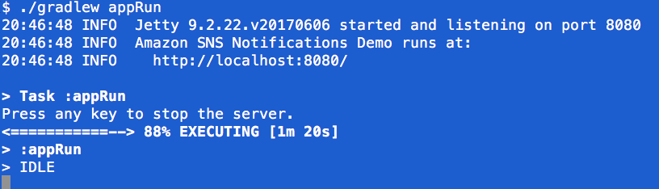

# Basic Amazon SNS integration demo for iOS and Android


--
### Introduction
This is a basic example of hooking up to Amazon SNS for registering and broadcasting push notifications to iOS and Android.

The demo is a simple JVM server written in Kotlin. The code has been kept very simple to focus on the Amazon SNS integration.

There is an expected level of understanding of mobile apps to be able to digest this. The integration of Firebase for Android and Push Notifications for Apple iOS into the mobile applications themselves is left to the user to research, but is well documented on the Google Firebase and Apple Notification developer sites.

--
### Prerequisites

1. Create an iOS application with push notifications enabled, and with an APNS certificate made. This certificate will be submitted to AWS SNS to allow it to communicate with Apple APNS on your behalf. Integrate the APNS notification lifecycle code into the iOS application.
2. Create an Android application and register it into Firebase as a new project to obtain a 'server key' which will be submitted to AWS SNS to allow it to communicate with Google GCM/Firebase on your behalf. Integrate the Firebase SDK and configuration into the Android application.
3. Create an AWS account, then create an iOS 'platform application' and an Android 'platform application' within the SNS service area.
4. Attach your Apple APNS certificate into the iOS platform application credentials in AWS SNS console.
5. Attach your Firebase server key into the Android platform application credentials in AWS SNS console.
6. Create your preferred method of credentials for communicating with AWS. See the 'Amazon.kt' source file in the repository for some basic info on how to do this.

--
### Running the server

Clone or download the repository. The demo server is Gradle based but you can use IntelliJ to open it for editing. If you wish to run the server via **Terminal** use the following Gradle command:

```
./gradlew appRun
```

> Note: the first time you run or open the project it may take a while to download all the required dependencies.

After successfully starting you should see:



--
To open the project in IntelliJ do the following:

